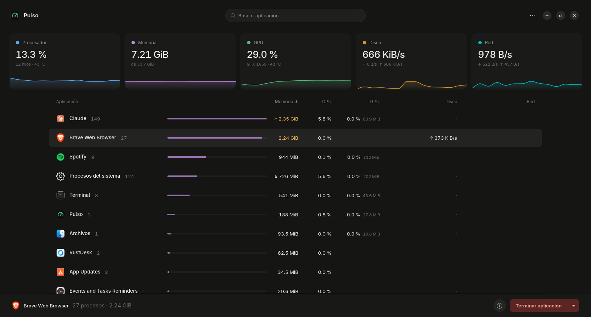

# Pulso

**Monitor de recursos por aplicación para GNOME** que muestra lo que cada app consume *de verdad*.



- **Memoria real (PSS):** la memoria compartida se reparte entre los procesos que la usan, en lugar de
  contarse varias veces como hacen la mayoría de los monitores. Por eso Brave, Spotify o las apps de
  Electron aparecen con su consumo real, que suele ser bastante menor.
- **CPU, GPU NVIDIA** (uso y VRAM por app), **disco** y **red** (TCP), con historial de 5 minutos.
- Clic en una métrica de arriba para ver el detalle: uso por hilo, composición de la memoria, VRAM por app…
- Acciones sobre la app seleccionada: **Terminar**, **Matar**, **Detener** y **Reanudar**.

> **Versión beta (0.1.0 beta 1).** Funciona y se usa a diario, pero puede tener fallos.
> Si encuentras uno, abre un [issue](https://github.com/ARIOT117/pulso/issues).

---

## Requisitos

| | |
|---|---|
| **Sistema** | Distribución con `apt` y **libadwaita 1.6 o superior**: Ubuntu **24.10 o posterior** (probado en 26.04 LTS), Debian **13 «trixie»** o posterior y sus derivadas. |
| **No compatible** | Ubuntu 24.04 LTS, Linux Mint 22.x, Pop!_OS 24.04, Zorin OS 17 y otras basadas en Ubuntu 24.04 (su libadwaita es demasiado antigua). Tampoco Fedora, Arch, etc. (no usan `apt`). |
| **Escritorio** | GNOME recomendado. En otros escritorios funciona, pero la agrupación de procesos por app es menos precisa. |
| **GPU** | Opcional. Las columnas de GPU necesitan una tarjeta **NVIDIA** con el driver propietario; sin ella simplemente se ocultan. |

**¿No sabes si tu sistema es compatible?** Ejecuta esto:

```bash
apt-cache policy gir1.2-adw-1
```

Mira la línea **Candidato** (o *Candidate*): tiene que ser **1.6** o mayor (por ejemplo `1.7.x` o `1.9.x`).
Si pone `1.5.x` o menos, Pulso no se podrá instalar en ese sistema.

---

## Instalación

Abre una terminal (**Ctrl + Alt + T**) y ejecuta estos comandos **uno por uno**. Te pedirá tu contraseña
la primera vez (es normal: `sudo` instala programas para todo el sistema).

**1. Descarga la clave que firma el repositorio** (sirve para que `apt` compruebe que los paquetes son auténticos):

```bash
sudo wget -qO /usr/share/keyrings/pulso-archive-keyring.gpg https://ariot117.github.io/pulso/pulso-archive-keyring.gpg
```

**2. Añade el repositorio de Pulso:**

```bash
printf 'Types: deb\nURIs: https://ariot117.github.io/pulso\nSuites: ./\nSigned-By: /usr/share/keyrings/pulso-archive-keyring.gpg\n' | sudo tee /etc/apt/sources.list.d/pulso.sources
```

**3. Actualiza la lista de paquetes e instala Pulso:**

```bash
sudo apt update
```

```bash
sudo apt install pulso
```

**Listo.** Abre Pulso desde **Actividades** (tecla Super) escribiendo *Pulso*, o desde la terminal con:

```bash
pulso
```

### Alternativa: instalar solo el archivo .deb

Si prefieres no añadir el repositorio (en ese caso **no** recibirás actualizaciones automáticas):

```bash
wget https://ariot117.github.io/pulso/pulso_0.1.0~beta1_all.deb
```

```bash
sudo apt install ./pulso_0.1.0~beta1_all.deb
```

Usa `sudo apt install ./archivo.deb` (con el `./` delante) y no `dpkg -i`: así `apt` instala también las dependencias.

---

## Actualizar

Si instalaste con el repositorio, Pulso se actualiza junto con el resto del sistema:

```bash
sudo apt update && sudo apt upgrade
```

## Desinstalar

Quitar el programa:

```bash
sudo apt remove pulso
```

Quitar también el repositorio y su clave (opcional):

```bash
sudo rm /etc/apt/sources.list.d/pulso.sources /usr/share/keyrings/pulso-archive-keyring.gpg && sudo apt update
```

Borrar tus ajustes de Pulso (opcional):

```bash
rm -rf ~/.config/pulso
```

---

## Problemas frecuentes

| Mensaje o síntoma | Solución |
|---|---|
| `wget: orden no encontrada` | Instálalo con `sudo apt install wget` y repite el paso 1. |
| `pulso : Depende: gir1.2-adw-1 (>= 1.6) pero …` o «dependencias incumplidas» | Tu sistema es demasiado antiguo (ver [Requisitos](#requisitos)). |
| `NO_PUBKEY …` o «no se pudieron verificar las firmas» | La clave no se descargó bien: repite el paso 1 y luego `sudo apt update`. |
| `E: No se ha podido localizar el paquete pulso` | Falta `sudo apt update` después del paso 2, o el archivo del paso 2 quedó mal: compruébalo con `cat /etc/apt/sources.list.d/pulso.sources` (deben salir 4 líneas). |
| `Conflicting values set for option Signed-By` o avisos de entradas duplicadas | Tienes el repositorio añadido dos veces. Borra el antiguo con `sudo rm -f /etc/apt/sources.list.d/pulso.list` y ejecuta `sudo apt update`. |
| Pulso no aparece en Actividades | Espera unos segundos o cierra y abre sesión. También puedes abrirlo con `pulso` en la terminal, que mostrará el error si lo hay. |
| No aparecen las columnas de GPU | No hay una GPU NVIDIA con su driver propietario. Compruébalo con `nvidia-smi`. |
| Al terminar una app: «El sistema no permite enviar señales a …» | Esa app pertenece a otro usuario (por ejemplo, root) o está protegida por el sistema. |
| La memoria de «Procesos del sistema» aparece con «≥» | Normal: la memoria de los procesos de root no se puede leer sin privilegios, así que esa cifra es un mínimo. |

---

## Limitaciones conocidas

- La memoria (PSS) de los procesos de root no se puede leer sin privilegios: se marca con «≥» y no se suma.
- Red: solo se mide TCP. El tráfico UDP/QUIC (parte del de los navegadores) no aparece por app.
- La memoria se relee cada 5 s en procesos activos y cada 15 s en inactivos, porque es costosa de calcular.
- GPU: solo NVIDIA por ahora.

---

## Para desarrolladores

### Ejecutar desde el código

Dependencias: `python3-gi`, `gir1.2-gtk-4.0`, `gir1.2-adw-1` e `iproute2`.

```bash
git clone https://github.com/ARIOT117/pulso.git
cd pulso
python3 -m pulso                     # abrir la app
python3 -m pulso.collector           # tabla en la terminal para comprobar los números
PULSO_NON_UNIQUE=1 python3 -m pulso  # segunda instancia, aunque ya haya una abierta
```

### Publicar una versión nueva

1. Sube `__version__` y `VERSION_LABEL` en `pulso/__init__.py`, añade la entrada en `packaging/changelog`
   y la versión en `packaging/io.github.ariot117.Pulso.metainfo.xml`.
2. `packaging/build-deb.sh` → genera `dist/pulso_<versión>_all.deb`.
3. `PULSO_GPG_KEY=$(cat packaging/SIGNING_KEY_FINGERPRINT) packaging/build-repo.sh` → genera `repo/` firmado.
4. Publica el contenido de `repo/` en la rama `gh-pages`.

### Señales y apps protegidas

Si el kernel rechaza una señal (por ejemplo, porque AppArmor protege una app snap), Pulso pide a systemd
que la envíe a la unidad de esa app (`systemctl --user kill`). Solo lo hace con unidades propias de la app
(`app-*` o `snap.*`), nunca con servicios compartidos.

---

Licencia [MIT](LICENSE) · © 2026 ARIOT117
